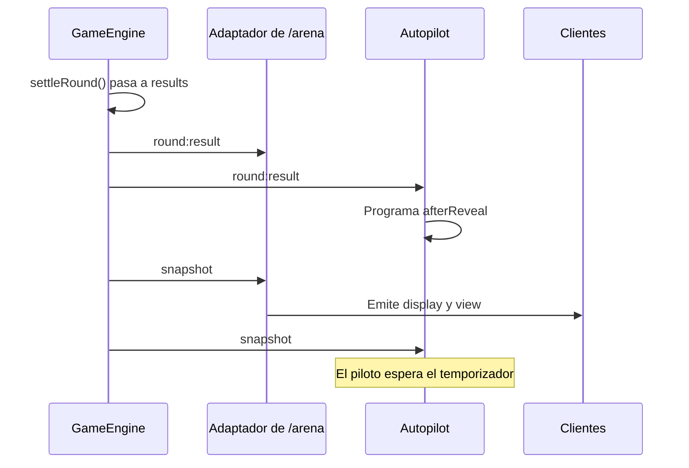
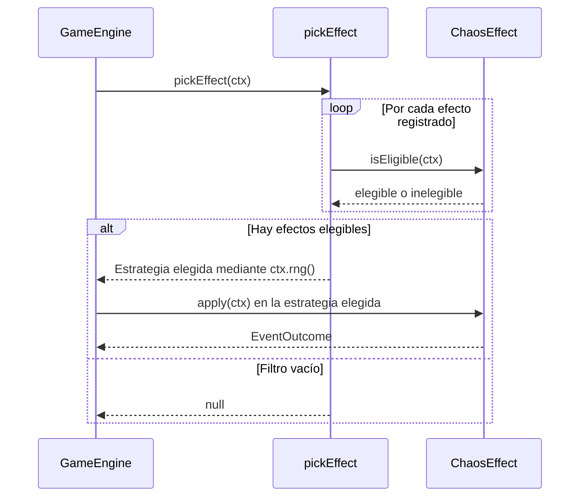
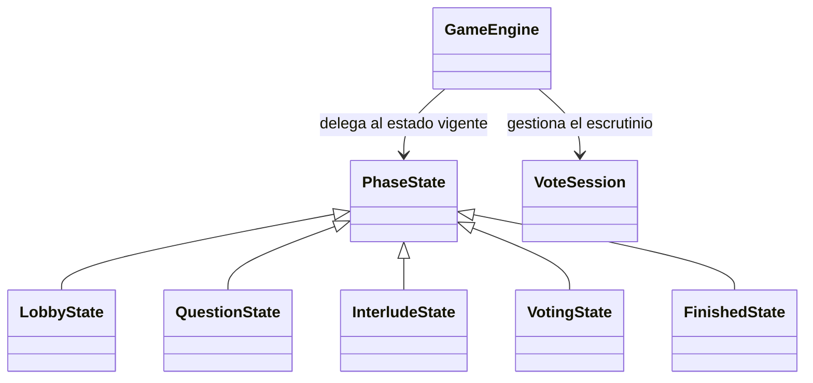

# Patrones de diseño en el backend de ChaosArena

En una partida, **State** determina qué acciones admite la fase actual, **Strategy** encapsula las reglas de cada evento del caos y **Observer** permite que las vistas y el piloto reaccionen a los cambios del motor.

## Observer

**Problema.** Al cerrar una ronda, el piloto debe programar el avance y los clientes deben recibir las vistas que les corresponden. El motor publica cambios tipados a través de suscripciones. Cada observador decide cómo reaccionar, y `subscribe` devuelve una función para cancelar la suscripción.

| Participante | Responsabilidad y ubicación |
| --- | --- |
| Sujeto, `GameEngine` | Mantiene los listeners y los invoca con `notify`. Al cerrar la ronda, cambia a resultados y publica `round:result` seguido de `snapshot`. [`game.ts:153–155`](../backend/src/game.ts#L153-L155) · [`game.ts:179–192`](../backend/src/game.ts#L179-L192) · [`game.ts:335–347`](../backend/src/game.ts#L335-L347) |
| Contrato, `EngineListener` y `EngineChange` | Tipan la función suscrita y los mensajes que recibe. [`game.ts:22–34`](../backend/src/game.ts#L22-L34) |
| Observador de vistas, `onChange` | `attachArena` suscribe el adaptador de `/arena`. Ante `snapshot`, construye y emite `display` para el proyector y `view` para cada conexión de jugador. [`liveArena.ts:53–78`](../backend/src/liveArena.ts#L53-L78) · [`liveArena.ts:113–160`](../backend/src/liveArena.ts#L113-L160) |
| Observador de automatización, `attachAutopilot` | Ante `round:result`, programa la revelación y decide si pide evento, asamblea o avance. Al terminar una votación, programa el avance. [`autopilot.ts:54–81`](../backend/src/autopilot.ts#L54-L81) |
| Observador del protocolo de sala, `attachSocketPublisher` | Convierte cambios del motor en emisiones Socket.IO por rol. El servidor lo instala al crear la sala mediante `room:create`. [`publisher.ts:19–64`](../backend/src/publisher.ts#L19-L64) · [`server.ts:93`](../backend/src/server.ts#L93) |

Durante el cierre en `/arena`, el piloto recibe el resultado antes de que el adaptador emita las vistas actualizadas.



El registro y la baja usan la misma referencia al listener. [`GameEngine.subscribe`](../backend/src/game.ts#L179-L182)

```ts
  subscribe(listener: EngineListener): () => void {
    this.listeners.add(listener);
    return () => this.listeners.delete(listener);
  }
```

## Strategy

**Problema.** La ruleta necesita elegir entre efectos con requisitos y consecuencias distintas. El motor prepara un contexto común, el selector filtra los efectos elegibles y la estrategia elegida aplica su propia regla. La lista opcional de `pickEffect` permite sustituir el conjunto de estrategias en la selección.

| Participante | Responsabilidad y ubicación |
| --- | --- |
| Cliente, `GameEngine.runEvent` | Prepara el contexto con jugadores activos, RNG y acceso al próximo modificador. Ejecuta el efecto elegido una vez por intermedio y publica el resultado. [`game.ts:350–372`](../backend/src/game.ts#L350-L372) · [`game.ts:508–510`](../backend/src/game.ts#L508-L510) |
| Contrato, `ChaosEffect` y `EventContext` | Cada estrategia declara su tipo e implementa `isEligible` y `apply` sobre el mismo contexto. [`events.ts:9–31`](../backend/src/events.ts#L9-L31) |
| Estrategia concreta, `blackHole` | Elige un activo con puntaje positivo y le resta el 20 % redondeado hacia abajo. [`events.ts:33–42`](../backend/src/events.ts#L33-L42) |
| Estrategia concreta, `doubleOrNothing` | Si queda una pregunta y el motor puede programar un modificador, configura el doble de base y una penalización de 50. [`events.ts:44–51`](../backend/src/events.ts#L44-L51) |
| Estrategia concreta, `lootBox` | Requiere al menos un activo y suma 150 a uno elegido al azar. [`events.ts:53–61`](../backend/src/events.ts#L53-L61) |
| Estrategia concreta, `hack` | Requiere dos activos o más con alguna diferencia de puntaje. Elige dos jugadores distintos e intercambia sus puntajes. [`events.ts:63–77`](../backend/src/events.ts#L63-L77) |
| Selector, `pickEffect` y `defaultEffects` | Filtra por elegibilidad, usa el RNG para dar la misma probabilidad a cada efecto elegible y devuelve `null` si el filtro queda vacío. [`events.ts:79–86`](../backend/src/events.ts#L79-L86) |

El piloto decide si intenta un evento. Si lo intenta, `pickEffect` decide cuál sale. Con Doble o nada, `openRound` consume el modificador pendiente y `scoreRound` aplica el multiplicador a la base y penaliza el error u omisión del activo. [Decisión del piloto](../backend/src/autopilot.ts#L54-L58) · [Consumo del modificador](../backend/src/game.ts#L282-L297) · [Puntuación de la ronda](../backend/src/scoring.ts#L33-L45)



El filtro determina el tamaño del intervalo que se divide entre los efectos elegibles. [`pickEffect`](../backend/src/events.ts#L82-L86)

```ts
export function pickEffect(ctx: EventContext, effects: readonly ChaosEffect[] = defaultEffects): ChaosEffect | null {
  const eligible = effects.filter((e) => e.isEligible(ctx));
  if (eligible.length === 0) return null;
  return eligible[Math.floor(ctx.rng() * eligible.length)];
}
```

## State

**Problema.** Una misma acción cambia de significado según la fase. `close` liquida una ronda durante la pregunta y una asamblea durante la votación. El motor delega la acción en el objeto de estado vigente. Cada estado admite sus operaciones y llama al motor para efectuar la transición.

| Participante | Responsabilidad y ubicación |
| --- | --- |
| Contexto, `GameEngine` | Guarda un `PhaseState`, le delega las acciones externas y solo entrega un vencimiento al mismo estado que programó el temporizador. [`game.ts:153–155`](../backend/src/game.ts#L153-L155) · [`game.ts:194–222`](../backend/src/game.ts#L194-L222) · [`game.ts:516–522`](../backend/src/game.ts#L516-L522) |
| Estado base, `PhaseState` | Define la interfaz de acciones y los rechazos por defecto, como `WRONG_PHASE`, `ROUND_CLOSED` y `VOTE_CLOSED`. [`game.ts:40–67`](../backend/src/game.ts#L40-L67) |
| `LobbyState` | Admite ingreso y configuración. `start` abre la primera pregunta si hay jugadores. [`game.ts:69–88`](../backend/src/game.ts#L69-L88) |
| `QuestionState` | Acepta respuestas y cierra la ronda por comando o vencimiento. [`game.ts:90–106`](../backend/src/game.ts#L90-L106) |
| `InterludeState` | Gestiona resultados, evento aplicado y votación cerrada. Admite avanzar, intentar evento, abrir votación o finalizar. El motor verifica si el evento o la votación ya se usaron. [`game.ts:108–127`](../backend/src/game.ts#L108-L127) · [`game.ts:350–351`](../backend/src/game.ts#L350-L351) · [`game.ts:374–380`](../backend/src/game.ts#L374-L380) |
| `VotingState` | Acepta votos y cierra la sesión por comando o vencimiento. `VoteSession` valida y cuenta votos. Al cerrarse, el motor puede convertir al expulsado en fantasma y pasa a `InterludeState('voting')`, conservando el nombre de fase `voting`. [`game.ts:129–141`](../backend/src/game.ts#L129-L141) · [`voting.ts:32–77`](../backend/src/voting.ts#L32-L77) · [`game.ts:399–419`](../backend/src/game.ts#L399-L419) |
| `FinishedState` | Permite salir o reiniciar. Al reiniciar, el motor limpia los datos de la partida y vuelve al lobby conservando a los jugadores. [`game.ts:143–151`](../backend/src/game.ts#L143-L151) · [`game.ts:263–274`](../backend/src/game.ts#L263-L274) |



El estado vigente recibe el comando y la instancia del motor. [`GameEngine.command`](../backend/src/game.ts#L196-L198)

```ts
  command(command: GameCommand) {
    this.state.command(this, command);
  }
```

## Demostración en vivo

Desde la raíz del repositorio, con las dependencias instaladas, ejecuta las pruebas por patrón y abre las líneas indicadas para relacionar cada aserción con el código.

| Patrón | Comando | Qué mostrar |
| --- | --- | --- |
| Observer | `npm exec -w backend -- tsx --test src/autopilot.test.ts src/liveArena.test.ts` | Abre [`autopilot.ts`, suscripción a resultados](../backend/src/autopilot.ts#L66-L76). En la [prueba de avance automático](../backend/src/autopilot.test.ts#L21-L31), el reloj simulado lleva el motor de resultados a la siguiente pregunta. En la [prueba de integración de la arena](../backend/src/liveArena.test.ts#L58), muestra cómo el proyector se suscribe y cómo el anfitrión recibe el resumen al final. |
| Strategy | `npm exec -w backend -- tsx --test src/events.test.ts src/scoring.test.ts` | Abre [`events.ts`, selector](../backend/src/events.ts#L79-L86) y [`game.ts`, ejecución](../backend/src/game.ts#L350-L372). Muestra los límites del RNG en la [prueba de selección uniforme](../backend/src/events.test.ts#L77-L90) y el rechazo del segundo evento en la [prueba de aplicación única](../backend/src/events.test.ts#L92). Sigue Doble o nada hasta la [prueba de puntuación](../backend/src/scoring.test.ts#L65). |
| State | `npm exec -w backend -- tsx --test src/game.test.ts src/voting.test.ts` | Abre [`game.ts`, lobby y pregunta](../backend/src/game.ts#L69-L106). Muestra que `next` se rechaza en lobby y que el ingreso se bloquea tras `start` en la [prueba de fases](../backend/src/game.test.ts#L23-L31). Abre [`VotingState`](../backend/src/game.ts#L129-L141) y usa la [prueba de cierre idempotente](../backend/src/voting.test.ts#L78) para explicar el cierre de la sesión. |

La prueba de integración de la arena usa sockets y temporizadores reales. Para una demostración corta de Observer, ejecuta solo `src/autopilot.test.ts` con el mismo comando.

Para recorrer los tres patrones con un solo comando, ejecuta `npm test -w backend`.
